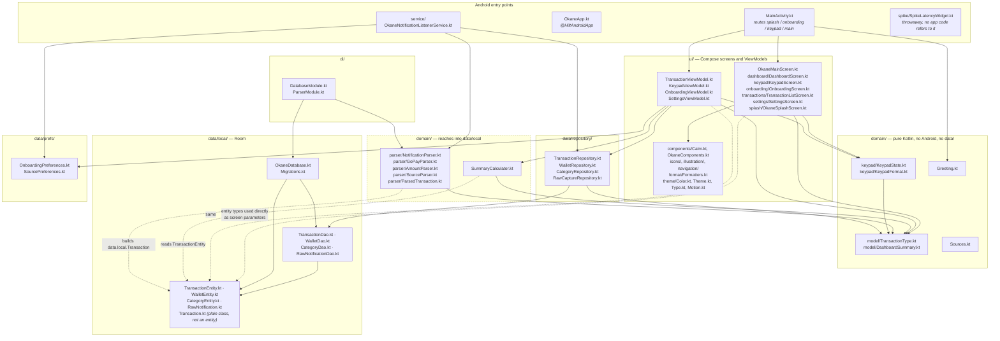

# Okane — module map

What is actually in `app/src/main/java/com/example/okane/`, and which way the
dependencies point. This is drawn from the imports as they exist, not from an
idealised architecture — see [Where the layering is not clean](#where-the-layering-is-not-clean).

Solid arrows are ordinary inward dependencies. **Dotted arrows are the ones
that break the layering** — they are real, and explained below.

---

## What each module is responsible for

### Entry points

**`MainActivity.kt`** is the only Activity and the app's entire router. There is
no navigation library: it holds two `rememberSaveable` booleans (`splashDone`,
`showKeypad`) plus `onboardingViewModel.completed`, and a `Crossfade` picks
between the splash, onboarding, the keypad, and the main tabbed screen. All four
ViewModels are obtained here with `by viewModels()` and their state is passed
down as parameters.

**`OkaneApp.kt`** exists only to carry `@HiltAndroidApp`.

**`service/OkaneNotificationListenerService.kt`** runs whenever the system
delivers a notification, independently of whether the app is open. It filters,
optionally captures the raw notification for parser development, asks
`NotificationParser` to interpret it, and writes the result through
`TransactionRepository`. It is the second, fully separate write path into the
database.

**`spike/SpikeLatencyWidget.kt`** is a Glance widget built to measure
tap-to-pixel latency for a deferred home screen widget. It is registered in
`AndroidManifest.xml` but **no application code references it** — see
[migrations.md](migrations.md) and the surprises section of the final doc.

### `ui/`

Screens are stateless: they take values and callbacks, and hold no repository
references. State lives in the four ViewModels, which expose `StateFlow`s built
with `stateIn(..., WhileSubscribed(5_000), ...)`.

- **`TransactionViewModel`** feeds the dashboard and history: transactions,
  `DashboardSummary`, wallet balances, the uncategorised inbox, and the wallet
  and category lists used to resolve names.
- **`KeypadViewModel`** owns a single `KeypadState` and performs commits.
- **`OnboardingViewModel`** owns `OnboardingUiState` and writes nothing until
  the user finishes.
- **`SettingsViewModel`** owns the per-app notification toggles and the
  discovery-sample counter.

`components/Calm.kt` is the calm design system: `CalmCard`, `PastelTile`,
`CalmChip`, `CalmButton`, `CalmFab`, `CalmBottomSheet`, plus the `pressScale`
and `calmEntrance` modifiers. `OkaneComponents.kt` keeps the older names
(`OkaneCard`, `SectionHeader`, `StatusChip`, `OkaneButton`) on top of it.
`icons/` holds thin line icons, `illustration/` the Canvas-drawn stones and
leaves, `navigation/OkaneRoute.kt` the animated top-level routing, and
`theme/Motion.kt` the shared easing and durations. `format/Formatters.kt`
renders `Rp1.234.567` for lists and the dashboard.

### `domain/` — the pure half

**`keypad/KeypadState.kt`** is the input engine: digits, the `000` key,
backspace, the 12-digit cap, wallet and category selection, transfer mode, and
`canCommit`. It has no Android imports so it can be unit-tested on the JVM, and
so a future widget could hold the same state in DataStore.
`keypad/KeypadFormat.kt` renders the keypad's own `Rp 500.000` form.

**`model/`** holds `TransactionType` (`IN`, `OUT`, `TRANSFER`),
`TransactionSource` (`MANUAL`, `NOTIFICATION`), and `DashboardSummary`. These
enums live here rather than beside the Room entities precisely so the pure
keypad package can reference them.

**`Greeting.kt`** maps an hour to `Ohayou` / `Konnichiwa` / `Konbanwa`.
**`Sources.kt`** lists the six supported financial app names.

### `domain/` — the half that isn't pure

**`SummaryCalculator.kt`** and **`parser/`** both import from `data.local`, so
they are domain by intent but not by dependency. Details below.

`parser/` turns a notification into a transaction: `NotificationParser` routes
by package name to a `SourceParser`, `AmountParser` handles Indonesian rupiah
separator ambiguity, and `GoPayParser` is the only implementation registered so
far.

### `data/repository/`

The only code allowed to touch DAOs. `TransactionRepository` has two write
paths — `add(Transaction)` for notifications and `addManual` / `addTransfer` for
the keypad — and owns the mapping between the two models. `WalletRepository`
enforces the wallet invariants (exactly one default, last wallet cannot be
archived). `CategoryRepository` is idempotent by `(name, type)`.
`RawCaptureRepository` stores discovery samples.

### `data/local/`

Room entities, DAOs, `OkaneDatabase` (version 4), and the hand-written
migrations. `Transaction.kt` is the odd one out: it lives here but is **not** a
Room entity — it is the notification path's own model.

### `data/prefs/`

Two thin `SharedPreferences` wrappers: whether onboarding has run, and which
financial apps the listener should act on.

### `di/`

`DatabaseModule` builds the Room database (registering `OKANE_MIGRATIONS`, with
destructive fallback deliberately off) and provides the four DAOs.
`ParserModule` provides `NotificationParser`.

---

## Where the layering is not clean

Three deviations, all real and all visible as dotted arrows above.

**1. `domain/` is split in half.** `domain/keypad/`, `domain/model/`,
`Greeting.kt` and `Sources.kt` depend on nothing. But `SummaryCalculator.kt`
imports `data.local.TransactionEntity`, and `parser/NotificationParser.kt`
imports `data.local.Transaction`. So "domain" is not an inner layer you can
extract — half of it points outward at the storage package. The package name
suggests a purity that only some of its contents have.

**2. The UI reaches past repositories into `data.local`.** Screens and
ViewModels take `TransactionEntity`, `WalletBalance`, `CategoryEntity` and
`WalletEntity` directly as parameters; there are no separate UI models. This is
a deliberate trade — a mapping layer for a single-module app would be a lot of
boilerplate — but it means a Room schema change ripples straight into composable
signatures, which is exactly what happened when `walletId` was added.

**3. Two write paths, two models, one table.** The keypad writes
`TransactionEntity` directly. The notification listener produces the plain
`data.local.Transaction`, which `TransactionRepository.add` maps into a
`TransactionEntity`. Both land in the `transactions` table. The indirection
exists so the listener and parsers never needed changing when the schema moved
underneath them, but it does mean `source` means two different things depending
on which class you are holding: the app name (`"GoPay"`) on `Transaction`, and
`MANUAL` vs `NOTIFICATION` on `TransactionEntity`.

---

## Two independent write paths

Worth holding in your head before reading any other doc: the database has two
producers that never call each other.

| | Keypad | Notification listener |
|---|---|---|
| Trigger | User taps `Keluar` / `Masuk` / `Pindahkan` | System delivers a notification |
| Entry point | `KeypadViewModel.commit` / `commitTransfer` | `OkaneNotificationListenerService.onNotificationPosted` |
| Repository call | `addManual` / `addTransfer` | `add(Transaction)` |
| `source` column | `MANUAL` | `NOTIFICATION` |
| `sourceApp` | `null` | `"GoPay"`, … |
| Wallet | Chosen by the user | Matched by name, else the default wallet |
| Duplicate protection | None needed | Unique index on `(sourceApp, type, amount, occurredAt)` |

The unique index only constrains the notification path, because `sourceApp` is
`NULL` for keypad rows and SQLite treats `NULL`s as distinct in a unique index.

---

Next: [flow-record-transaction.md](flow-record-transaction.md) traces a single
tap through all of these layers.
