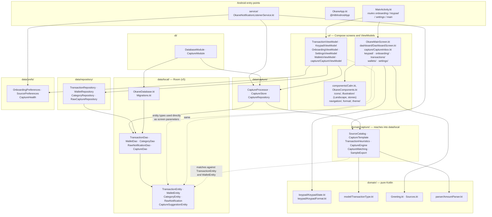

# Okane — module map

What is actually in `app/src/main/java/com/example/okane/`, and which way the
dependencies point. This is drawn from the imports as they exist, not from an
idealised architecture — see [Where the layering is not clean](#where-the-layering-is-not-clean).

Solid arrows are ordinary inward dependencies. **Dotted arrows are the ones
that break the layering** — they are real, and explained below.

---

## What each module is responsible for

### Entry points

**`MainActivity.kt`** is the only Activity and the app's entire router. There is
no navigation library: `okaneRoute()` derives one of Onboarding, Main, Keypad or
Settings from a few booleans, and `AnimatedContent` moves between them. The
system splash covers start-up; there is no second, animated splash. The
Activity also turns the status bar icons light while Home's sky is on screen.

**`OkaneApp.kt`** exists only to carry `@HiltAndroidApp`.

**`service/OkaneNotificationListenerService.kt`** runs whenever the system
delivers a notification, independently of whether the app is open. It drops
everything that is not a supported finance source, hands the rest to
`CaptureProcessor`, keeps non-OTP discovery samples, and records health
timestamps. It is the second, fully separate write path into the database.

### `ui/`

Screens are stateless: they take values and callbacks, and hold no repository
references. State lives in the ViewModels, which expose `StateFlow`s built with
`stateIn(..., WhileSubscribed(5_000), ...)`.

- **Home** (`dashboard/DashboardScreen.kt`) is only a greeting and the total of
  every wallet, over `illustration/Landscape.kt` — a sky, rolling hills and one
  tree drawn in code, whose palette follows the time of day.
- **Riwayat** lists history and, above it, the "Perlu konfirmasi" card from
  `capture/`. The navigation bar shows a dot on Riwayat when it has items.
- **The add button** beside the navigation bar opens the keypad from any page.
- **`TransactionViewModel`** feeds history and name resolution;
  **`CaptureViewModel`** the confirmation inbox; **`KeypadViewModel`** owns one
  `KeypadState`; **`OnboardingViewModel`** writes nothing until the user
  finishes; **`SettingsViewModel`** owns source toggles, listener health and
  sample sharing; **`WalletsViewModel`** owns Dompetku.

`components/Calm.kt` is the calm design system (`CalmCard`, `CalmChip`,
`CalmButton`, `CalmFab`, `CalmBottomSheet`, `pressScale`, `calmEntrance`).
`icons/` holds thin line icons and `illustration/` the Canvas drawings;
nothing in the UI ships as a bitmap.

### `domain/`

**`keypad/KeypadState.kt`** is the input engine: digits, the `000` key,
backspace, the 12-digit cap, wallet and category selection, transfer mode, and
`canCommit`. **`model/`** holds `TransactionType` and `TransactionSource`.
**`Greeting.kt`** maps an hour to `Ohayou` / `Konnichiwa` / `Konbanwa`.
**`Sources.kt`** lists the supported financial app names.
**`parser/AmountParser.kt`** reads rupiah amounts out of text.

**`capture/`** holds the rules for automatic capture: which packages and
senders belong to which source, data-driven templates, keyword heuristics, the
engine that decides record / suggest / ignore, and the duplicate and transfer
matching. See `docs/riset-pencatatan-otomatis.md`.

### `data/`

- **`capture/`**: `CaptureProcessor` applies the write rules under one lock;
  `CaptureStore` is its storage seam (Room in the app, in-memory in tests).
- **`repository/`**: the UI's access to DAOs. `WalletRepository` enforces the
  wallet invariants (exactly one default, last wallet cannot be archived).
- **`local/`**: Room entities, DAOs, `OkaneDatabase` (version 5) and the
  hand-written migrations.
- **`prefs/`**: onboarding flag, per-source toggles, listener health.

### `di/`

`DatabaseModule` builds the Room database (registering `OKANE_MIGRATIONS`, with
destructive fallback deliberately off) and provides the DAOs. `CaptureModule`
provides the single `CaptureProcessor` the service and the UI share.

---

## Where the layering is not clean

**1. `domain/capture/` reads storage types.** The matching rules take lists of
`TransactionEntity` and `WalletEntity`, so this part of "domain" points outward
at `data.local`. It is still pure in the sense that matters for testing: no
Android, no database, plain lists in and decisions out.

**2. The UI reaches past repositories into `data.local`.** Screens and
ViewModels take `TransactionEntity`, `WalletBalance`, `CategoryEntity` and
`WalletEntity` directly as parameters; there are no separate UI models. This is
a deliberate trade — a mapping layer for a single-module app would be a lot of
boilerplate — but a Room schema change ripples straight into composable
signatures.

---

## Two independent write paths

The database has two producers that never call each other.

| | Keypad | Notification listener |
|---|---|---|
| Trigger | User taps `Keluar` / `Masuk` / `Pindahkan` | System delivers a notification |
| Entry point | `KeypadViewModel.commit` / `commitTransfer` | `OkaneNotificationListenerService` → `CaptureProcessor.process` |
| Writes | `TransactionRepository.addManual` / `addTransfer` | `CaptureDao` (transactions, or a suggestion to confirm) |
| `source` column | `MANUAL` | `NOTIFICATION` |
| `sourceApp` | `null` | `"GoPay"`, … |
| Wallet | Chosen by the user | Matched by name or alias, else the default wallet |
| Duplicate protection | None needed | Re-post window, similar-row check, unique index on `(sourceApp, type, amount, occurredAt)` |

The unique index only constrains the notification path, because `sourceApp` is
`NULL` for keypad rows and SQLite treats `NULL`s as distinct in a unique index.
